# MySQL Query Exercises

### 1. Table Setup
#### • Create Query
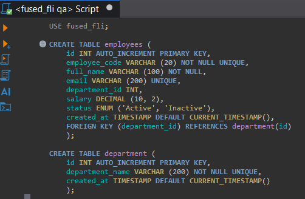

#### • Purpose and Description
this create query syntax is used to create tables under fused_fli db.

#### • Actual result and Expected result
actual and expected result - both tables were created with no errors.

### 2. Sample Data
#### • Insert Query
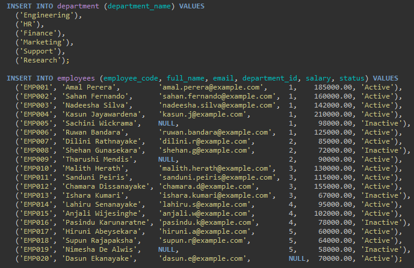

#### • Purpose and Description
this insert query syntax is used to add data into relevent or specific tables

#### • Actual result and Expected result
actual and expected result - Inserted successfully. COUNT shows 6 departments and 20 employees.

## A. Basic SELECT Queries
#### A1. Retrieve all employee records
SELECT * FROM employees;

**Query:**
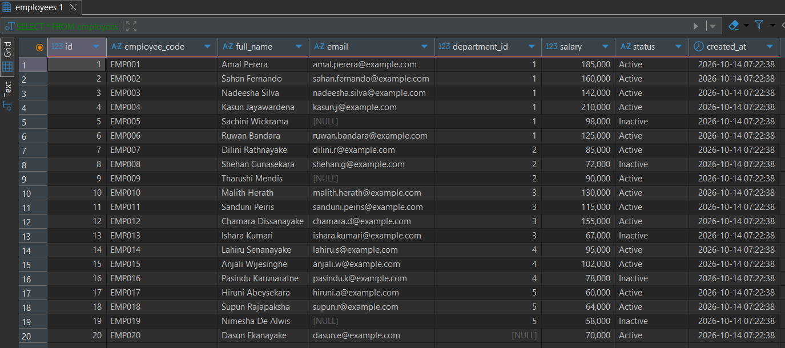
**Description and Purpose:**
this select query synatx was used to retrieves every column and every row from the employees table. this can be done because of *

**Expected and Actual**
All 20 employee records with every column, successful.

#### A2. Retrieve names, emails and salaries
SELECT full_name, email, salary

FROM employees;

**Query:**

**Description and Purpose:**
this select query synatx was used to Retrieves only the full_name, email and salary columns for every employee.

**Expected and Actual**
20 rows with 3 columns (full_name, email, salary). shown successfully

#### A3. Retrieve employees in a specific department

**Query:**

SELECT full_name

FROM employees 

WHERE department_id = 2;

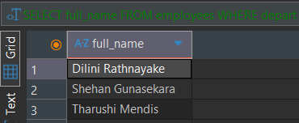

**Description and Purpose:**
this select query syntax was used to retrieve only the employees in department 2 (HR). WHERE filters the rows so only matching ones are returned. Useful when you need to see the staff of one department.

**Expected and Actual**
3 rows (Dilini, Shehan and Tharushi) with every column. shown successfully.

#### A4. Retrieve employees with salary greater than a specified amount

**Query:**

SELECT *

FROM employees

WHERE salary > 100000.00;

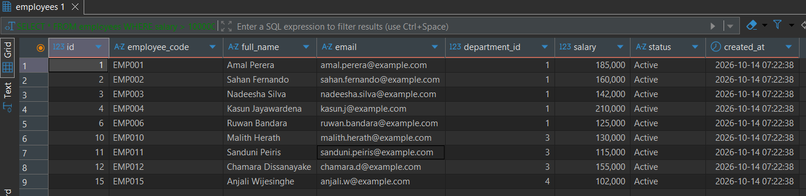

**Description and Purpose:**
this select query syntax was used to retrieve employees earning more than 100,000. WHERE with > compares each salary and keeps only the higher ones. Useful for finding high earners, e.g. for budget or pay reviews.

**Expected and Actual**
9 rows, all with salary above 100,000. shown successfully.

#### A5. Retrieve employees using multiple filtering conditions

SELECT *

FROM employees

WHERE department_id = 2 AND status = 'Active';

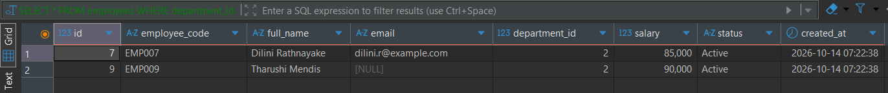

**Description and Purpose:**
this select query syntax was used to retrieve employees who are in department 2 (HR) and are also Active. AND means both conditions must be true for a row to be returned. Useful when filtering by more than one thing at once, e.g. only current staff in a department.

**Expected and Actual**
2 rows (Dilini and Tharushi). Shehan is excluded because he is Inactive. shown successfully.

## B. Filtering and Sorting

#### B1. Use WHERE, AND, OR, IN, BETWEEN and LIKE

SELECT *

FROM employees

WHERE salary BETWEEN 50000.00 AND 100000.00

  AND (department_id = 1 OR department_id = 2)

  AND full_name LIKE 's%'

  AND status IN ('Active', 'Inactive');

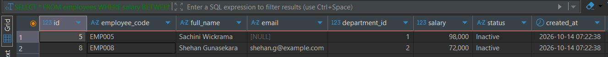

**Description and Purpose:**
this select query syntax combines all six filtering keywords. WHERE starts the filter, AND joins conditions that must all be true, OR (in brackets) allows either department, BETWEEN keeps salaries in a range, LIKE matches names starting with S, and IN checks status against a list. Useful when searching with several rules at once.

**Expected and Actual**
2 rows (Sachini Wickrama and Shehan Gunasekara). shown successfull.

#### B2. Retrieve employees whose names start with a specific letter

Done in the previous example.

#### B3. Retrieve employees within a salary range

Done in the previous example.

#### B4. Sort employees by salary in descending order

**Query**

SELECT *

FROM employees

ORDER BY salary DESC;

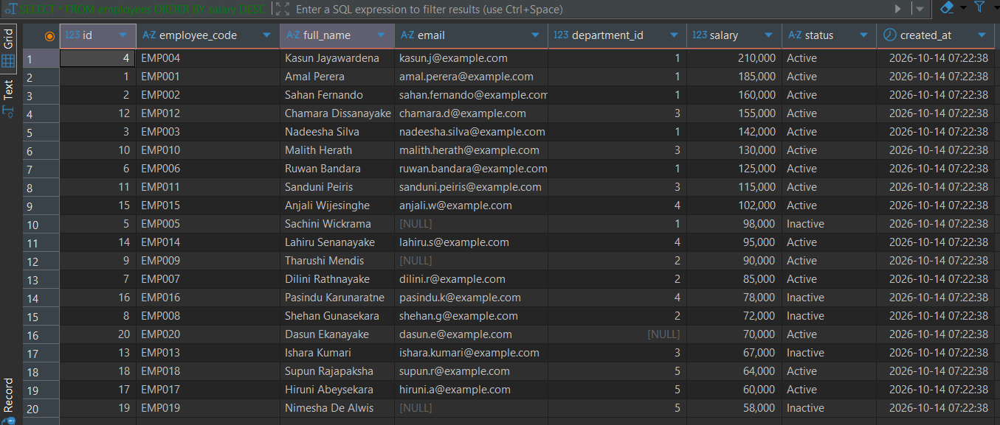

**Description and Purpose:**
this select query syntax sorts all employees by salary from highest to lowest. ORDER BY chooses the column to sort by, and DESC means descending (biggest first). Useful for seeing top earners first, e.g. for pay reviews.

**Expected and Actual**
20 rows, starting with Kasun Jayawardena (210,000) and ending with Nimesha De Alwis (58,000). shown successfully.

#### B5. Retrieve the top five highest-paid employees

**Query:**

SELECT *

FROM employees

ORDER BY salary DESC LIMIT 5;

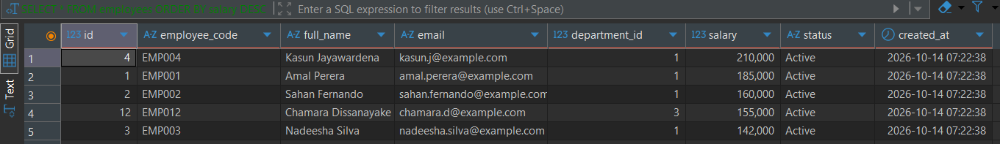

**Description and Purpose:**
this select query syntax sorts employees by salary from highest to lowest and then keeps only the first 5 rows. LIMIT controls how many rows are returned. Useful for "top N" lists, like the highest earners or best sellers.

**Expected and Actual**
5 rows: Kasun Jayawardena (210,000), Amal Perera (185,000), Sahan Fernando (160,000), Chamara Dissanayake (155,000) and Nadeesha Silva (142,000). shown successfully.

#### B6. Handle NULL values

**Query:**

SELECT *

FROM employees

WHERE email IS NULL;

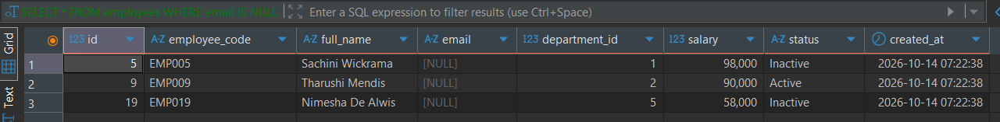

**Description and Purpose:**
this select query syntax finds employees whose email is missing (NULL). NULL means no value, so = NULL does not work; IS NULL must be used instead. Useful for finding incomplete records that need fixing.

**Expected and Actual**
3 rows (Sachini Wickrama, Tharushi Mendis and Nimesha De Alwis). shown successfully.

## C. INSERT, UPDATE and DELETE

#### C1. Insert a new department

**Query:**

INSERT INTO department (department_name)

VALUES ('Operations');

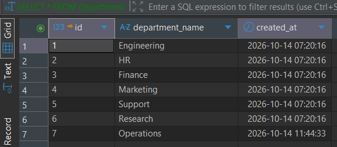

**Description and Purpose:**
this insert query syntax adds a new department called Operations. Only department_name is given because id and created_at are filled in automatically. The SELECT afterwards checks the row was added. Useful when the company creates a new department.

**Expected and Actual**
1 row inserted. The verify query shows Operations with id 7. shown successfully.

#### C2. Insert a new employee

**Query:**

INSERT INTO employees (employee_code, full_name, email, department_id, salary, status)

VALUES ('EMP021', 'Test Employee', 'test.employee@example.com', 7, 75000.00, 'Active');

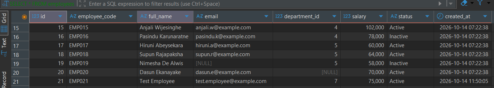

**Description and Purpose:**
this insert query syntax adds a new employee to the Operations department. The column list says which columns the values go into, in the same order. id and created_at are filled in automatically. Useful when a new person joins the company.

**Expected and Actual**
1 row inserted. The verify query shows Test Employee (EMP021) in department 7. shown successfully.

#### C3. Update an employee's salary

**Query:**

UPDATE employees

SET salary = 80000.00

WHERE employee_code = 'EMP021';

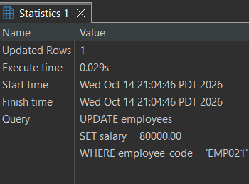

**Description and Purpose:**
this update query syntax changes the salary of one employee (EMP021) from 75,000 to 80,000. SET gives the new value, and WHERE uses the unique employee_code so only that one row is changed. The SELECT before and after confirms the change. Useful for pay raises or correcting a wrong salary.

**Expected and Actual**
1 row affected. Salary was 75,000 before and 80,000 after. shown successfully.

#### C4. Update multiple records using a condition

**Query:**

UPDATE employees

SET salary = salary + 10000

WHERE department_id = 5;

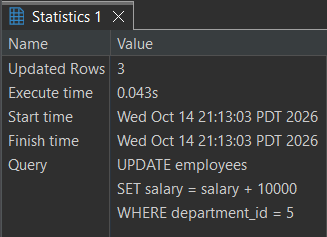

**Description and Purpose:**
this update query syntax gives every employee in department 5 (Support) a 10,000 raise. salary = salary + 10000 uses each row's current salary to calculate the new one. The WHERE matches several rows, so all of them are updated at once. Useful for department-wide pay changes.

**Expected and Actual**
3 rows affected. Salaries changed from 60,000 / 64,000 / 58,000 to 70,000 / 74,000 / 68,000. shown successfully.

#### C5. Delete a test employee safely

**Query:**

DELETE FROM employees

WHERE employee_code = 'EMP021';

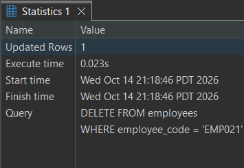

**Description and Purpose:**
this delete query syntax removes the test employee (EMP021). Running the SELECT first with the same WHERE confirms exactly which row will be deleted, so nothing else is removed by mistake. The WHERE uses the unique employee_code, so only one row can match. Without a WHERE, every row in the table would be deleted. Useful for removing test data or employees who have left.

**Expected and Actual**
1 row deleted. The before query shows Test Employee, and the after query returns 0 rows. shown successfully.

## D. Aggregate Functions

#### D1. Calculate the total number of employees

**Query:**

SELECT COUNT(*) AS total_employees

FROM employees;

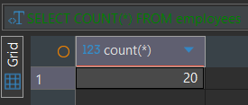

**Description and Purpose:**
this aggregate query syntax counts every row in the employees table. COUNT(*) counts all rows, even ones with NULL values. AS gives the result column a readable name. Useful for quick totals, like headcount reports.

**Expected and Actual**
1 row with the value 20. shown successfully.

#### D2. Calculate the average, minimum and maximum salary

**Query:**

SELECT AVG(salary) AS avg_salary,

  MIN(salary) AS min_salary,

  MAX(salary) AS max_salary

FROM employees;

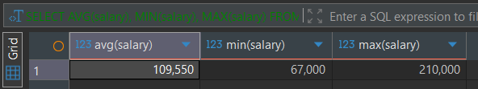

**Description and Purpose:**
this aggregate query syntax calculates the average, lowest and highest salary across all employees in one query. AVG, MIN and MAX each look at the salary column and return a single value. Useful for pay reports and spotting the salary range in the company.

**Expected and Actual**
1 row: avg_salary 109,550, min_salary 67,000, max_salary 210,000. shown successfully.

#### D3. Calculate the total salary expenditure

**Query:**

SELECT SUM(salary) AS total_salary

FROM employees;

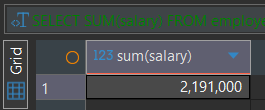

**Description and Purpose:**
this aggregate query syntax adds up the salary of every employee into one total. SUM works on a number column and returns a single value. Useful for knowing how much the company spends on salaries.

**Expected and Actual**
1 row with the value 2,191,000. shown successfully.

#### D4. Count employees in each department

**Query:**

SELECT department_id,

COUNT(*) AS employee_count

FROM employees

GROUP BY department_id;

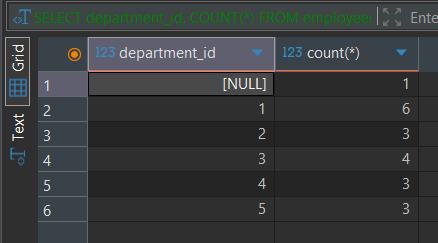

**Description and Purpose:**
this aggregate query syntax groups employees by department_id and counts how many are in each group. GROUP BY splits the rows into groups, and COUNT(*) runs on each group separately. The NULL group is the employee with no department. Useful for seeing team sizes.

**Expected and Actual**
6 rows: NULL → 1, dept 1 → 6, dept 2 → 3, dept 3 → 4, dept 4 → 3, dept 5 → 3. shown successfully.

#### D5. Retrieve departments with more than three employees

**Query:**

SELECT department_id,

COUNT(*) AS employee_count

FROM employees

GROUP BY department_id

HAVING COUNT(*) > 3;

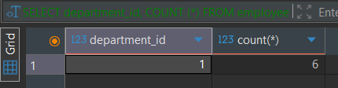

**Description and Purpose:**
this aggregate query syntax groups employees by department, counts them, and keeps only departments with more than 3 employees. HAVING filters groups after they are counted, while WHERE filters rows before grouping, so WHERE cannot be used here. Useful for finding the larger teams.

**Expected and Actual**
2 rows: dept 1 → 6 and dept 3 → 4. shown successfully.

## E. JOIN Queries

#### E1. Retrieve employees with their department names (INNER JOIN)

**Query:**

SELECT employees.full_name, department.department_name

FROM employees

INNER JOIN department ON employees.department_id = department.id;

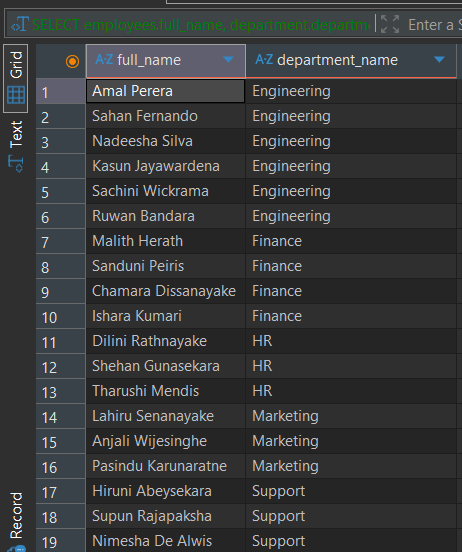

**Description and Purpose:**
this join query syntax combines the employees and department tables to show each employee's name next to their department name. ON links employees.department_id to department.id (the foreign key). INNER JOIN only returns rows that match on both sides. Useful whenever you need readable department names instead of just ids.

**Expected and Actual**
19 rows. Dasun Ekanayake is not shown because he has no department, and Research and Operations are not shown because they have no employees. shown successfully.

#### E2. Retrieve all departments, including those without employees (LEFT JOIN)

**Query:**

SELECT department.department_name, employees.full_name

FROM department

LEFT JOIN employees ON department.id = employees.department_id;

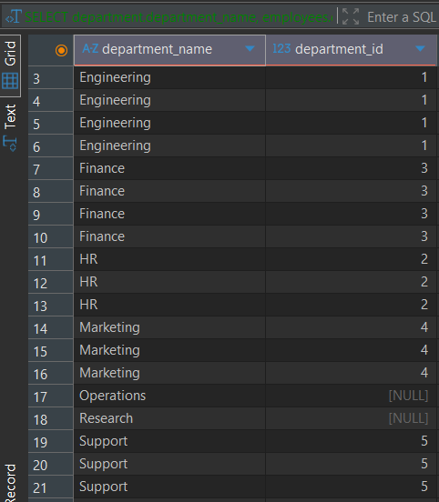

**Description and Purpose:**
this join query syntax shows every department and the employees in it. LEFT JOIN keeps all rows from the left table (department), even if no employee matches. Where there is no match, the employee columns show NULL. Useful for finding departments with no staff.

**Expected and Actual**
21 rows. 19 rows show departments with their employees, and Research and Operations appear with NULL because they have no employees. shown successfully.

#### E3. Find employees who belong to a particular department

**Query:**

SELECT employees.full_name, department.department_name

FROM employees

INNER JOIN department ON employees.department_id = department.id

WHERE department.department_name = 'HR';

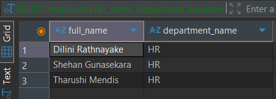

**Description and Purpose:**
this join query syntax finds all employees in the HR department by its name. The JOIN brings in department names, so WHERE can filter by 'HR' instead of needing to know its id. Useful when you know a department's name but not its id.

**Expected and Actual**
3 rows: Dilini Rathnayake, Shehan Gunasekara and Tharushi Mendis, all in HR. shown successfully.

#### E4. Compare INNER JOIN and LEFT JOIN results

**Comparison:**

INNER JOIN only shows rows where there is a match in both tables, so it gave 19 rows. Research and Operations did not show because no employees are in them, and Dasun did not show because he has no department. LEFT JOIN shows every department from the left table even if nobody is in it, so it gave 21 rows. Research and Operations showed up with NULL because there were no employees to match. So INNER JOIN is used when you only want matching data, and LEFT JOIN is used when you want to see everything from one table, including the ones with no match

## F. Subqueries

#### F1. Find employees earning more than the average salary

**Query:**

SELECT full_name, salary

FROM employees

WHERE salary > (SELECT AVG(salary) FROM employees);

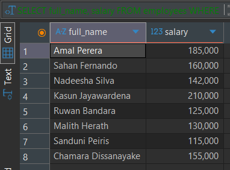

**Description and Purpose:**
this subquery syntax finds employees who earn more than the average salary. The query inside the brackets runs first and calculates the average (109,550), then the outer query uses that number in the WHERE. Useful when a filter depends on a value that has to be calculated first.

**Expected and Actual**
8 rows: Amal Perera, Sahan Fernando, Nadeesha Silva, Kasun Jayawardena, Ruwan Bandara, Malith Herath, Sanduni Peiris and Chamara Dissanayake. shown successfully. with the salary column to show that the users are actually above the average.

#### F2. Find the highest-paid employee in each department

**Query:**

SELECT e.department_id, e.full_name, e.salary

FROM employees e

WHERE e.salary = ( SELECT MAX(salary)

FROM employees

WHERE department_id = e.department_id);

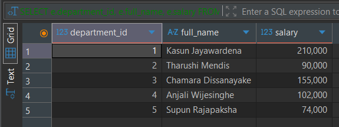

**Description and Purpose:**
this subquery syntax finds the top earner in each department. e is a short name (alias) for the outer employees table. For each employee, the inner query finds the highest salary in that employee's own department, and the row is kept only if their salary equals that max. Useful for finding the top performer or highest earner per group.

**Expected and Actual**
5 rows, one per department: Kasun (1), Tharushi (2), Chamara (3), Anjali (4) and Supun (5). shown successfully.

#### F3. Retrieve employees in departments meeting a specified condition

**Query:**

SELECT e.department_id, e.full_name
FROM employees e
WHERE e.department_id IN (
SELECT department_id
FROM employees
GROUP BY department_id
HAVING COUNT(*) > 3);

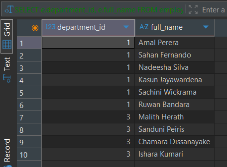

**Description and Purpose:**
this subquery syntax finds all employees who work in departments with more than 3 employees. The inner query runs first and returns a list of department ids (1 and 3). The outer query then uses IN to keep only employees whose department is in that list. Useful when the filter depends on a group condition.

**Expected and Actual**
10 rows: 6 employees from department 1 (Engineering) and 4 from department 3 (Finance). shown successfully.

#### H1. Update inside a transaction, then ROLLBACK

**Query:**

SET autocommit = 0;

START TRANSACTION;

UPDATE employees e

SET e.salary = e.salary * 102000.00

WHERE e.employee_code = 'EMP019';

SELECT employee_code, salary FROM employees WHERE employee_code = 'EMP019';

ROLLBACK;

SELECT employee_code, salary FROM employees WHERE employee_code = 'EMP019';

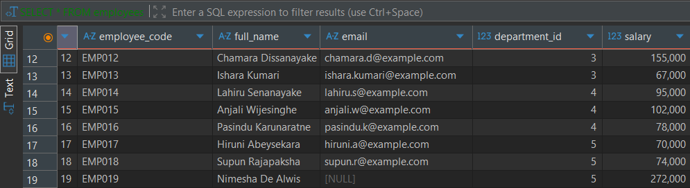
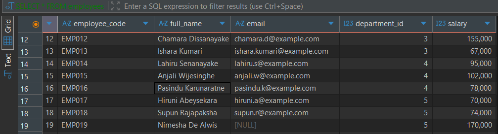

**Description and Purpose:**
this transaction syntax groups changes so they can be undone. START TRANSACTION begins it, the UPDATE multiplies EMP019's salary by 102000.00, and ROLLBACK cancels the change before it is saved. autocommit had to be turned off first, because DBeaver was saving each statement straight away. Useful for testing risky changes safely.

**Expected and Actual**
After the UPDATE, salary shows 272000. After ROLLBACK, salary goes back to 170000.00. shown successfully.

